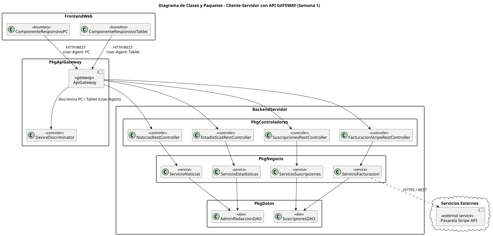
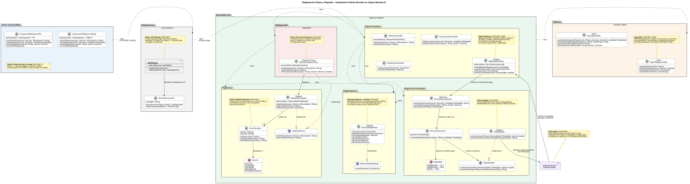
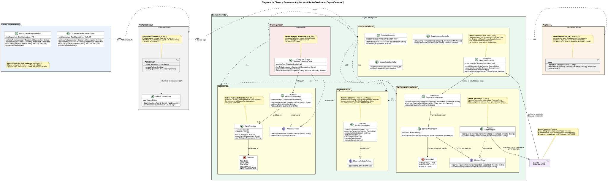

# Sistema de Periodico Digital - Practica 1

## Informacion General
* **Asignatura:** Diseno y Arquitectura del Software (DAS)
* **Curso Academico:** 2026-2027
* **Institucion:** Universidad Rey Juan Carlos (URJC)

## Equipo de Trabajo y Asignacion de Roles
El equipo aplica la separacion de roles establecida en la normativa de la asignatura:

| Integrante | Rol Asignado | Responsabilidades Principales |
| :--- | :--- | :--- |
| **Antonio Machuca** | Arquitecto Software Senior (ASS) | Formulacion y captura de decisiones arquitectonicas en formato MADR. |
| **Enrique Aldama** | Arquitecto Software Senior (ASS) | Formulacion y captura de decisiones arquitectonicas en formato MADR. |
| **Sergio Gonzalez** | Arquitecto Software Cognitivo (ASC) | Cuestionamiento critico, deteccion de fricciones y propuesta de alternativas. |
| **Sara Guillen** | Arquitecto Software Cognitivo (ASC) | Cuestionamiento critico, analisis de requisitos y validacion de arquitectura. |
| **David Sticea** | Arquitecto Software Junior (ASJ) | Modelado y documentacion UML en PlantUML (diagramas de clases y paquetes). |
| **Elena Romera** | Arquitecto Software Junior (ASJ) | Modelado y documentacion UML en PlantUML (diagramas de clases y paquetes). |

## Estructura del Repositorio
* `Requisitos/`: requisitos funcionales y de dominio del sistema.
* `Decisiones/`: registros de decision arquitectonica (ADR) en formato MADR.
* `Arquitecturas/`: modelos UML en PlantUML (.puml) y sus exportaciones (.svg, .png).

---

## Entregables de la Semana 1

### 1. Catalogo de Requisitos
* **Ubicacion:** [`Requisitos/REQUISITOS.xlsx`](Requisitos/REQUISITOS.xlsx)
* **Descripcion:** 6 Requisitos Funcionales (RF1 a RF6) y 3 Requisitos de Dominio (RD1 a RD3).

### 2. Registro de Decisiones Arquitectonicas (MADR)
* **[ADR-0001.1: Seleccion Inicial de Estilo Arquitectonico Global](Decisiones/0001.1-seleccion-estilo-arquitectonico-global.md)**
  * *Requisito Clave:* RD3 (Bases de datos con PostgreSQL 19).
  * *Decision Inicial:* Monolito en capas MVC con renderizado en servidor.
  * *Estado:* Anulada formalmente en ADR-0001.2.
* **[ADR-0001.2: Anulacion de la Decision 0001.1](Decisiones/0001.2-anulacion-decision-0001.1.md)**
  * *Requisito Clave:* RD2 (Comunicacion mediante HTTP/REST).
  * *Decision:* Revocacion del monolito por acoplamiento e incompatibilidad con RD2.
  * *Estado:* Aceptada.
* **[ADR-0001.3: Migracion a Estilo Cliente-Servidor con API REST](Decisiones/0001.3-migracion-estilo-cliente-servidor-api-rest.md)**
  * *Requisito Clave:* RD2 (Comunicacion mediante HTTP/REST).
  * *Decision:* Frontend web responsivo y backend API REST sin estado (stateless).
  * *Estado:* Aceptada (sustituye a ADR-0001.1).
* **[ADR-0002: Incorporacion de API Gateway para Discriminacion de Clientes](Decisiones/0002-api-gateway-discriminacion-clientes.md)**
  * *Requisito Clave:* RF1 (Discriminacion de clientes PC y Tablet).
  * *Decision:* API Gateway perimetral con `DeviceDiscriminator` (User-Agent -> `X-Device-Type`).
  * *Estado:* Aceptada.
* **[ADR-0003: Gestion de Cobros con Stripe Billing, Webhooks, Adapter y Observer](Decisiones/0003-gestion-cobros-stripe-billing-webhooks.md)**
  * *Requisitos Clave:* RF3 (Modalidades de suscripcion) y RF4 (Cobro externalizado).
  * *Decision:* Stripe Billing con webhooks, patrones `Adapter` (`StripeAdapter`) y `Observer` (`WebhookController`).
  * *Estado:* Aceptada.

### 3. Modelado Arquitectonico UML
* **Diagrama de Clases y Paquetes (Semana 1):**
  

---

## Entregables de la Semana 2

### 1. Registro de Decisiones Arquitectonicas (MADR)
* **[ADR-0004: Suscripciones Tematicas y Control de Acceso Anonimo](Decisiones/0004-autenticacion-anonima-tokens-suscriptores.md)**
  * *Requisito Clave:* RF2 (Suscripcion y baja anonima).
  * *Decision:* Patrones `Publish-Subscribe` (`CanalTematico`) y `Protection Proxy` (`NoticiasProtectionProxy`).
  * *Estado:* Aceptada.
* **[ADR-0005: Subsistema de Estadisticas de Uso con Observer y Facade](Decisiones/0005-estadisticas-uso-telemetria-postgresql.md)**
  * *Requisito Clave:* RF6 (Estadisticas de uso).
  * *Decision:* `ObservadorEstadisticas` y fachada `ServicioEstadisticas` con las cuatro metricas.
  * *Estado:* Aceptada.
* **[ADR-0006: Reintentos de Pago Fallido mediante Patron Retry](Decisiones/0006-reintentos-de-pago-patron-retry.md)**
  * *Requisito Clave:* RF5 (Reintentos de pago).
  * *Decision:* Patron `Retry` con la politica de reintentos delegada en Stripe.
  * *Estado:* Aceptada.

### 2. Modelado Arquitectonico UML
* **Diagrama de Clases y Paquetes (Semana 2):**
  

---

## Entregables de la Semana 3

### 1. Registro de Decisiones Arquitectonicas (MADR)
* **[ADR-0007: Acceso a PostgreSQL 19 mediante el Componente de Acceso de PostgreSQL (sin DAO)](Decisiones/0007-acceso-bases-de-datos-libpq-sin-dao.md)**
  * *Requisito Clave:* RD3 (Bases de datos con PostgreSQL 19).
  * *Decision:* Se elimina la capa DAO; los servicios acceden a la base de datos mediante `libpq`.
  * *Estado:* Aceptada.

### 2. Modelado Arquitectonico UML
* **Diagrama de Clases y Paquetes (Semana 3):** arquitectura cliente-servidor en capas (Cliente, PkgApiGateway, BackendServidor y PkgDatos) con los patrones de los ADR anotados en el propio diagrama.
  
